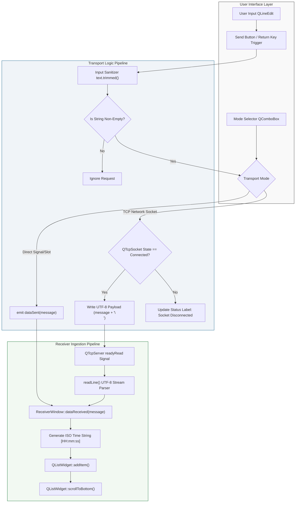
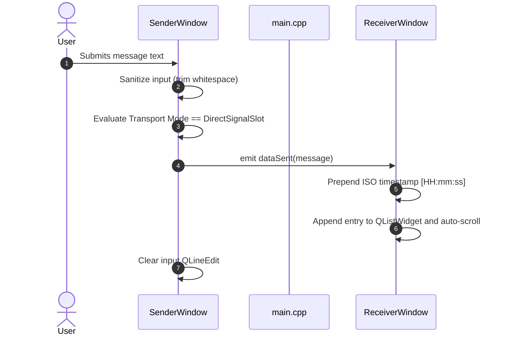
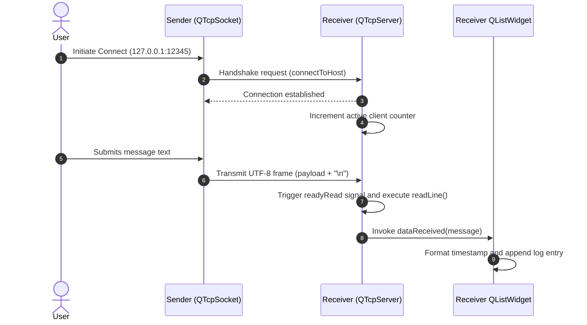

# SignalBridge (QtTwoWindows)

Dual-Channel Event-Driven Inter-Process Communication and Signal Architecture in Qt 6 and C++17.

---

## Technical Abstract

SignalBridge is a Qt 6 desktop application engineered to demonstrate decoupled, event-driven inter-window data transmission. The architecture provides two independent, isolated transport mechanisms:

1. **In-Process Signal/Slot Dispatch**: Type-safe, compile-time checked event routing utilizing Qt 6 member function pointer syntax (`SenderWindow::dataSent` to `ReceiverWindow::dataReceived`).
2. **Out-of-Process TCP Socket Streaming**: Non-blocking asynchronous network Inter-Process Communication (IPC) utilizing `QTcpSocket` and `QTcpServer` over local TCP ports.

The application strictly enforces component decoupling, resource safety via RAII and Qt's `QObject` parent-child ownership tree, and dynamic DPI-aware GUI layout management.

---

## System Architecture

### Component Hierarchy

```
+---------------------------------------------------------------------------------+
|                                APPLICATION MAIN                                 |
|                                   (main.cpp)                                    |
+----------------------------------------+----------------------------------------+
                                         |
               +-------------------------+-------------------------+
               |                                                   |
               v                                                   v
   +-----------------------+                           +-----------------------+
   |     SenderWindow      |                           |    ReceiverWindow     |
   |   (Top-Level QWidget) |                           |  (Top-Level QWidget)  |
   +-----------+-----------+                           +-----------+-----------+
               |                                                   |
               +--- Channel 1: Direct Signal/Slot ----------------->+
               |    [QObject::connect(&sender, &dataSent, ...)]   |
               |                                                   |
               +--- Channel 2: TCP Network Socket (Port 12345) ---->+
                    [QTcpSocket -> QTcpServer Stream Parsing]
```

### Data Pipeline Flow



---

## Communication Workflows

### 1. In-Process Direct Signal/Slot Workflow



### 2. Out-of-Process TCP Network Streaming Workflow



---

## Design Principles and Technical Specifications

### Transport Isolation State Machine
An explicit state machine manages active transport routing (`TransportMode::DirectSignalSlot` vs `TransportMode::TcpNetwork`). When Network Mode is selected, messages are transmitted strictly over the `QTcpSocket` stream. If the socket is disconnected or fails to establish a peer link (e.g., `Connection Refused`), transmission is blocked and reported via an error indicator. This eliminates double-emission, ghost deliveries, or unintended signal fallbacks.

### Non-Blocking Asynchronous Network I/O
Network reads are driven asynchronously by Qt's event loop (`QEventLoop`). The `ReceiverWindow` handles client stream ingestion using the `QTcpSocket::readyRead` signal and standard line framing (`canReadLine()`), ensuring continuous UI responsiveness during packet parsing.

### RAII and Memory Safety
Manual heap allocations and `delete` statements are eliminated. All child widgets, layout containers, and networking objects inherit from `QObject` and are tied to their parent container lifecycle. Stack-allocated top-level objects in `main.cpp` are safely managed through scope exit semantics.

### Dynamic DPI-Aware Layouts
Interface geometry relies on nested `QVBoxLayout` and `QHBoxLayout` managers. Coordinate hardcoding is prohibited, ensuring proper UI scaling across varying display DPI configurations and OS windowing systems.

---

## Repository Structure

```
SignalBridge/
├── CMakeLists.txt         # CMake 3.16+ project declaration & target configuration
├── main.cpp               # Entry point, CLI argument parsing, & window binding
├── SenderWindow.h         # Sender GUI class declaration & QTcpSocket members
├── SenderWindow.cpp       # Input validation, state management, & payload dispatch
├── ReceiverWindow.h       # Receiver GUI class declaration & QTcpServer members
├── ReceiverWindow.cpp     # Stream ingestion, line parsing, & log rendering
├── IMG/                   # High-resolution UI screenshots and artifacts
└── README.md              # System documentation
```

---

## Core Implementation References

### Modern Function-Pointer Signal/Slot Binding (`main.cpp`)

```cpp
// Direct In-Process Signal/Slot Connection using compile-time checked syntax
QObject::connect(&senderWindow, &SenderWindow::dataSent,
                 &receiverWindow, &ReceiverWindow::dataReceived);
```

### Input Sanitization and Transport Mode Isolation (`SenderWindow.cpp`)

```cpp
void SenderWindow::onSendClicked()
{
    const QString text = m_inputLineEdit->text().trimmed();

    if (text.isEmpty()) {
        return;
    }

    if (currentTransportMode() == TransportMode::DirectSignalSlot) {
        // Direct In-Process Signal/Slot Mode
        emit dataSent(text);
        m_inputLineEdit->clear();
    } else {
        // TCP Network Socket Mode
        if (m_tcpSocket->state() == QAbstractSocket::ConnectedState) {
            QByteArray payload = text.toUtf8() + "\n";
            m_tcpSocket->write(payload);
            m_tcpSocket->flush();
            m_inputLineEdit->clear();
        } else {
            // Block transmission and display socket status error
            m_statusLabel->setText(tr("Error: Cannot send — TCP socket is not connected!"));
            m_statusLabel->setStyleSheet(QStringLiteral("color: #c0392b; font-weight: bold;"));
        }
    }
}
```

### Log Item Formatting and View Auto-Scrolling (`ReceiverWindow.cpp`)

```cpp
void ReceiverWindow::dataReceived(const QString &message)
{
    const QString timestamp = QTime::currentTime().toString(QStringLiteral("HH:mm:ss"));
    const QString formattedEntry = QStringLiteral("[%1] %2").arg(timestamp, message);

    m_logWidget->addItem(formattedEntry);
    m_logWidget->scrollToBottom();
}
```

---

## Build and Compilation Guide

### System Requirements

- **Compiler**: C++17 compliant compiler (MSVC 2022, GCC 9+, or Clang 10+)
- **Build Toolchain**: CMake 3.16 or higher
- **Libraries**: Qt 6.0+ (`Widgets` and `Network` components)

### CMake Build Instructions

```bash
# 1. Clone repository
git clone https://github.com/ramanujaganesh26/SignalBridge.git
cd SignalBridge

# 2. Configure build system (specify Qt prefix path if required)
cmake -B build -DCMAKE_PREFIX_PATH="C:/Qt/6.8.3/msvc2022_64"

# 3. Build Release target
cmake --build build --config Release
```

---

## Execution Modes

### Single-Process Mode (Default)

Running the binary without arguments instantiates both windows on the stack and displays them side by side:

```bash
./build/Release/QtTwoWindows.exe
```

### Dual-Process Independent Execution

To verify process-isolated IPC over local network sockets, run each window in separate process instances:

```bash
# Instance 1: Receiver Server Process
./build/Release/QtTwoWindows.exe --receiver

# Instance 2: Sender Client Process
./build/Release/QtTwoWindows.exe --sender
```

---

## Compiler Compliance and Diagnostics

- Compiled with zero diagnostics under MSVC `/W4` and GCC/Clang `-Wall -Wextra -Wpedantic`.
- Configured with `QApplication::setQuitOnLastWindowClosed(true)` to guarantee process teardown when all top-level windows close.

---

## License

This project's source code is licensed under the terms of the MIT License as specified in [LICENSE](LICENSE).

The pre-compiled standalone Windows release bundle includes runtime libraries from the Qt Framework. Qt is licensed under the GNU Lesser General Public License (LGPLv3). For more details regarding Qt licensing, please visit [https://www.qt.io/licensing](https://www.qt.io/licensing).
