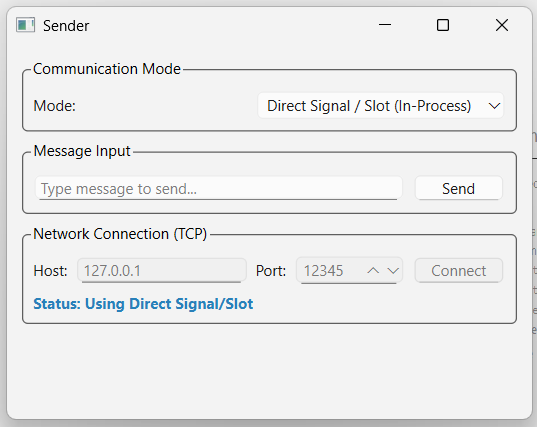
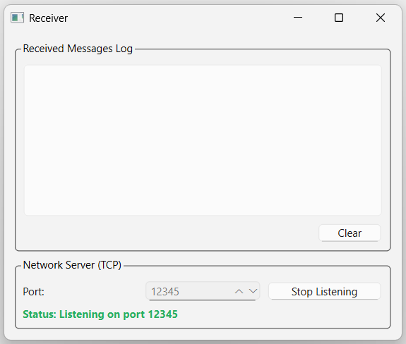

# QtTwoWindows (SignalBridge)

A Qt 6 C++ desktop application demonstrating decoupled event-driven architecture, dual-channel inter-process communication (IPC), and RAII memory management across separate top-level windows.

---

## Overview

QtTwoWindows (SignalBridge) demonstrates inter-window data transfer in Qt 6 using two distinct communication channels:

1. **In-Process Signal/Slot Dispatch**: Direct, type-safe message passing using Qt modern C++ pointer-to-member signals (`dataSent`) and slots (`dataReceived`).
2. **Out-of-Process TCP Socket Streaming**: Asynchronous network communication using `QTcpSocket` (client) and `QTcpServer` (server) over local TCP ports.

The application allows running both windows in a single process or executing them as separate, independent processes.

---

## Architecture & Design

### Component Structure

```
                      +-------------------+
                      |     main.cpp      |
                      +---------+---------+
                                |
             +------------------+------------------+
             |                                     |
             v                                     v
   +-------------------+                 +-------------------+
   |   SenderWindow    |                 |  ReceiverWindow   |
   | (Top-Level QWidget|                 | (Top-Level QWidget|
   +---------+---------+                 +---------+---------+
             |                                     |
             +-- Channel 1: Direct Signal/Slot --->+
             |   [QObject::connect(...)]           |
             |                                     |
             +-- Channel 2: TCP Socket (12345) --->+
                 [QTcpSocket -> QTcpServer]
```

### Key Technical Aspects

- **Decoupled Architecture**: `SenderWindow` and `ReceiverWindow` have no direct header dependencies on each other. Communication occurs strictly via Qt signals/slots or network sockets.
- **Transport Mode Guarding**: An explicit transport mode selector controls data routing. When TCP mode is selected and disconnected, message delivery via direct signals is suppressed to prevent silent fallback or duplicate logging.
- **Asynchronous I/O**: Network reading uses Qt event loop signals (`readyRead`) to parse incoming UTF-8 text lines without blocking the UI thread.
- **Object Ownership & Memory Management**: All UI components and network objects use Qt parent-child ownership (`QObject` hierarchy). No manual heap memory deletes are required.
- **Dynamic Layouts**: Layouts are built using nested `QVBoxLayout` and `QHBoxLayout` instances, allowing automatic scaling across screen resolutions and DPI settings.

---

## Screenshots

### Application Overview (Dual Window Mode)


### Active TCP Streaming Log


### Individual Window Components
| Sender Window | Receiver Window |
|---|---|
|  |  |

---

## Implementation Details

### 1. In-Process Signal/Slot Binding (`main.cpp`)

Direct communication is configured using compile-time type-checked member function pointers:

```cpp
QObject::connect(&senderWindow, &SenderWindow::dataSent,
                 &receiverWindow, &ReceiverWindow::dataReceived);
```

### 2. Transport Mode Switching & Input Sanitization (`SenderWindow.cpp`)

Inputs are trimmed and checked before transmission. The active transport mode dictates whether the message is emitted over signals or sent through the TCP stream:

```cpp
void SenderWindow::onSendClicked()
{
    const QString text = m_inputLineEdit->text().trimmed();

    if (text.isEmpty()) {
        return;
    }

    if (currentTransportMode() == TransportMode::DirectSignalSlot) {
        emit dataSent(text);
        m_inputLineEdit->clear();
    } else {
        if (m_tcpSocket->state() == QAbstractSocket::ConnectedState) {
            QByteArray payload = text.toUtf8() + "\n";
            m_tcpSocket->write(payload);
            m_tcpSocket->flush();
            m_inputLineEdit->clear();
        } else {
            m_statusLabel->setText(tr("Error: Cannot send — TCP socket is not connected!"));
            m_statusLabel->setStyleSheet(QStringLiteral("color: #c0392b; font-weight: bold;"));
        }
    }
}
```

### 3. Log Formatting & Auto-Scrolling (`ReceiverWindow.cpp`)

Incoming text messages are formatted with local system timestamps and appended to the `QListWidget` log view:

```cpp
void ReceiverWindow::dataReceived(const QString &message)
{
    const QString timestamp = QTime::currentTime().toString(QStringLiteral("HH:mm:ss"));
    const QString formattedEntry = QStringLiteral("[%1] %2").arg(timestamp, message);

    m_logWidget->addItem(formattedEntry);
    m_logWidget->scrollToBottom();
}
```

---

## Building and Running

### System Requirements

- C++17 capable compiler (MSVC 2022, GCC 9+, or Clang 10+)
- CMake 3.16 or higher
- Qt 6.0+ (Widgets and Network modules)

### Build Steps

```bash
# Configure the build directory
cmake -B build -DCMAKE_PREFIX_PATH="C:/Qt/6.8.3/msvc2022_64"

# Build the executable
cmake --build build --config Release
```

*(Update `-DCMAKE_PREFIX_PATH` to point to your local Qt installation directory if Qt is not on the system PATH.)*

---

## Execution Options

### Single-Process Mode (Default)

Running the binary launches both windows side by side:

```bash
./build/Release/QtTwoWindows.exe
```

### Independent Process Mode

The application supports command-line flags to run windows as separate processes:

```bash
# Start the Receiver server process
./build/Release/QtTwoWindows.exe --receiver

# Start the Sender client process in a separate terminal
./build/Release/QtTwoWindows.exe --sender
```

---

## Code Quality

- Compiled with high warning levels (`/W4` on MSVC, `-Wall -Wextra -Wpedantic` on GCC/Clang) with zero warnings.
- Uses `QApplication::setQuitOnLastWindowClosed(true)` to ensure clean application shutdown without orphan background processes.

---

## License

This project is licensed under the MIT License.
