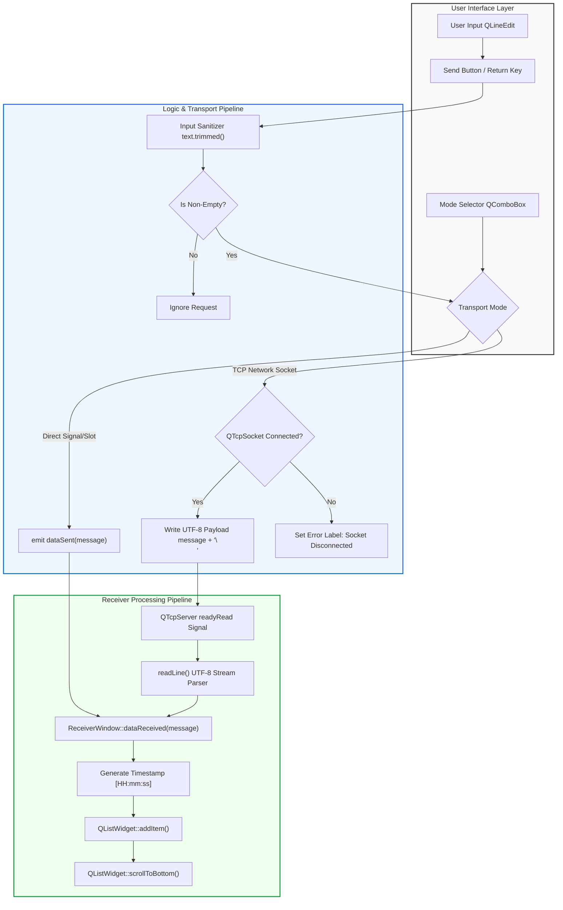
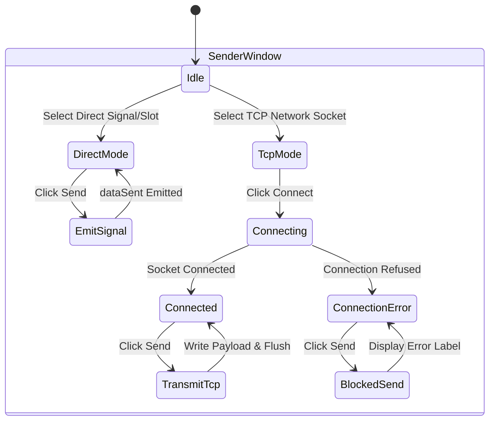
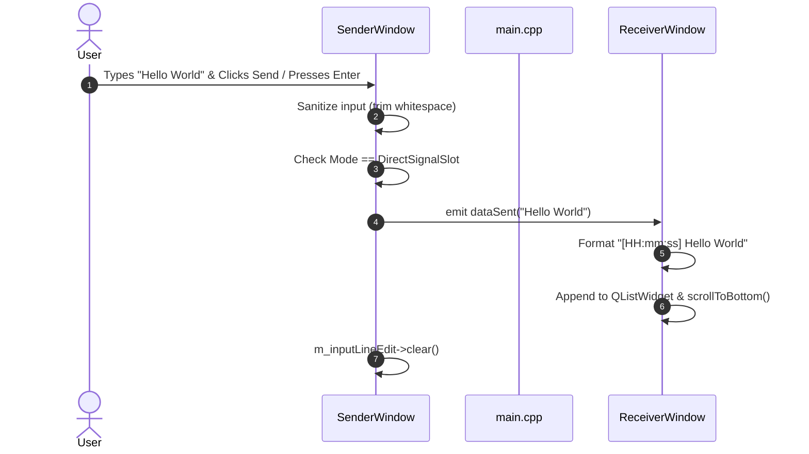
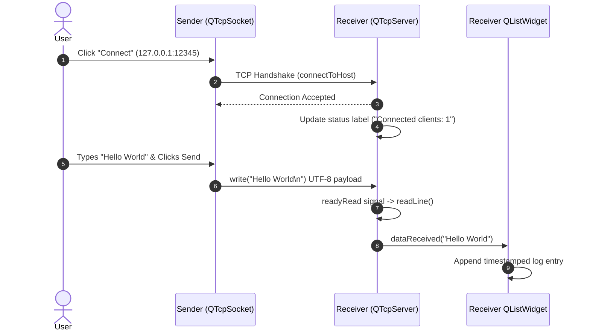

<div align="center">

# 🚀 QtTwoWindows (SignalBridge)

### *High-Performance Event-Driven IPC & Dual-Window Qt 6 C++ Architecture*

[](https://en.cppreference.com/w/cpp/17)
[](https://www.qt.io/)
[](https://cmake.org/)
[](LICENSE)
[]()

<p align="center">
  <b>A modern C++17 / Qt 6 desktop application demonstrating decoupled event-driven architecture, dual-channel Inter-Process Communication (In-Process Direct Signals vs. Out-of-Process TCP Sockets), robust RAII memory safety, and clean OOP design patterns.</b>
</p>

</div>

---

## 📖 Overview

**QtTwoWindows** (also known as *SignalBridge*) is an architectural demonstration built using **Qt 6 Widgets** and **CMake**. It illustrates how two distinct top-level application windows—a **Sender** and a **Receiver**—can transmit data across boundaries using two decoupled communication models:

1. **In-Process Signal/Slot Dispatch**: Type-safe, compile-time checked direct message passing via modern C++ pointer-to-member Qt signals (`dataSent`) and slots (`dataReceived`).
2. **Out-of-Process TCP Socket Streaming**: Non-blocking asynchronous network IPC using `QTcpSocket` (Client) and `QTcpServer` (Server) over local host ports.

---

## 🖼️ Visual Gallery

<div align="center">

### 1. Dual-Window In-Process Communication Mode
*Side-by-side view showing the Sender window with mode selection and the Receiver window with real-time log tracking.*


---

### 2. Live Out-of-Process TCP Socket Streaming
*Demonstrating active client connection on port 12345 with real-time timestamped data formatting `[HH:mm:ss] Hello World`.*


</div>

<details>
<summary><b>🔍 Zoom In / Expand Individual Component Screenshots (Click to Expand)</b></summary>

<br>

| Sender Component | Receiver Component |
| :---: | :---: |
|  |  |

</details>

---

## 🏗️ Architecture & Data Pipeline

```
+---------------------------------------------------------------------------------+
|                                 APPLICATION MAIN                                |
|                                   (main.cpp)                                    |
+----------------------------------------+----------------------------------------+
                                         |
               +-------------------------+-------------------------+
               |                                                   |
               v                                                   v
   +-----------------------+                           +-----------------------+
   |     SenderWindow      |                           |    ReceiverWindow     |
   |   (Top-Level QWidget) |                           |  (Top-Level QWidget)  |
   +-----------+-----------+                           +-----------+-----------+
               |                                                   |
               +--- Mode 1: Direct Signal/Slot -------------------->+
               |    [QObject::connect(&sender, &dataSent, ...)]   |
               |                                                   |
               +--- Mode 2: TCP Network Socket (Port 12345) ------>+
                    [QTcpSocket -> QTcpServer Stream Parsing]
```

<details open>
<summary><b>🔍 Zoom In / Expand High-Resolution System Pipeline & Data Flow Diagram (Click to Collapse / Expand)</b></summary>

<br>



</details>

<details>
<summary><b>🔍 Zoom In / Expand Sender State Machine Diagram (Click to Expand)</b></summary>

<br>



</details>

---

## 🔄 Sequence Diagrams

<details>
<summary><b>🔍 Zoom In / Expand Interactive Sequence Diagrams (Click to Expand)</b></summary>

<br>

### 1. In-Process Direct Signal/Slot Mode



### 2. Out-of-Process TCP Network Mode



</details>

---

## 📦 Project Structure

```
QtTwoWindows/
├── CMakeLists.txt         # CMake 3.16+ build configuration & Qt 6 linking
├── main.cpp               # Application entry point, CLI parser, & window initialization
├── SenderWindow.h         # Sender UI declaration, signals, & QTcpSocket members
├── SenderWindow.cpp       # Input validation, mode switching, & TCP transmission
├── ReceiverWindow.h       # Receiver UI declaration, slots, & QTcpServer members
├── ReceiverWindow.cpp     # Log formatting, auto-scrolling, & socket stream parsing
├── IMG/                   # High-resolution application screenshots
└── README.md              # Project documentation
```

---

## 💻 Deep Dive: Major Implementation Highlights

<details>
<summary><b>🔍 Zoom In / Expand Core Source Code Snippets (Click to Expand)</b></summary>

<br>

### 1. Modern Function-Pointer Signal/Slot Binding ([main.cpp](file:///c:/Users/RAM/Documents/SignalBridge/main.cpp#L40-L45))

```cpp
// Direct In-Process Signal/Slot Connection using compile-time checked syntax
QObject::connect(&senderWindow, &SenderWindow::dataSent,
                 &receiverWindow, &ReceiverWindow::dataReceived);
```

### 2. Input Sanitization & Transport Mode Guarding ([SenderWindow.cpp](file:///c:/Users/RAM/Documents/SignalBridge/SenderWindow.cpp#L125-L150))

```cpp
void SenderWindow::onSendClicked()
{
    const QString text = m_inputLineEdit->text().trimmed();

    // Ignore empty or whitespace-only input
    if (text.isEmpty()) {
        return;
    }

    if (currentTransportMode() == TransportMode::DirectSignalSlot) {
        // Direct In-Process Signal/Slot Mode
        emit dataSent(text);
        m_inputLineEdit->clear();
    } else {
        // TCP Network Socket Mode
        if (m_tcpSocket->state() == QAbstractSocket::ConnectedState) {
            QByteArray payload = text.toUtf8() + "\n";
            m_tcpSocket->write(payload);
            m_tcpSocket->flush();
            m_inputLineEdit->clear();
        } else {
            // Guard against disconnected TCP socket
            m_statusLabel->setText(tr("Error: Cannot send — TCP socket is not connected!"));
            m_statusLabel->setStyleSheet(QStringLiteral("color: #c0392b; font-weight: bold;"));
        }
    }
}
```

### 3. Log Formatting & Auto-Scrolling ([ReceiverWindow.cpp](file:///c:/Users/RAM/Documents/SignalBridge/ReceiverWindow.cpp#L70-L83))

```cpp
void ReceiverWindow::dataReceived(const QString &message)
{
    // Format entry as "[HH:mm:ss] <message>"
    const QString timestamp = QTime::currentTime().toString(QStringLiteral("HH:mm:ss"));
    const QString formattedEntry = QStringLiteral("[%1] %2").arg(timestamp, message);

    // Append to log and scroll to newest item
    m_logWidget->addItem(formattedEntry);
    m_logWidget->scrollToBottom();
}
```

</details>

---

## ⚙️ Build & Installation Guide

### Prerequisites

- **Compiler**: C++17 compliant compiler (MSVC 2022, GCC 9+, or Clang 10+)
- **Build System**: CMake 3.16 or higher
- **Framework**: Qt 6.0+ (`Widgets` and `Network` components)

### Building via CMake

```bash
# 1. Clone the repository
git clone https://github.com/ramanujaganesh26/SignalBridge.git
cd SignalBridge

# 2. Configure build directory (specify Qt prefix path if Qt is in custom directory)
cmake -B build -DCMAKE_PREFIX_PATH="C:/Qt/6.8.3/msvc2022_64"

# 3. Build executable in Release mode
cmake --build build --config Release
```

---

## 🚀 Execution Modes

### Mode A: Dual-Window Single Process (Default)

Launch the application directly to open both windows side by side:

```bash
./build/Release/QtTwoWindows.exe
```

### Mode B: Multi-Process Independent Execution

Run two separate application instances in distinct terminal windows to demonstrate true process-isolated IPC over local network sockets:

```bash
# Terminal 1: Receiver Server Process
./build/Release/QtTwoWindows.exe --receiver

# Terminal 2: Sender Client Process
./build/Release/QtTwoWindows.exe --sender
```

---

## 🛡️ Code Quality Standards

- **Zero Compiler Warnings**: Verified under MSVC `/W4` and GCC/Clang `-Wall -Wextra -Wpedantic`.
- **Standards Compliance**: Native C++17 constructs (`std::as_const`, `QStringLiteral`, `qobject_cast`).
- **Clean Teardown**: `QApplication::setQuitOnLastWindowClosed(true)` ensures complete application termination without leaving background processes hanging.

---

## 📝 License

Distributed under the **MIT License**. See `LICENSE` for more information.
